# CS6886 – Systems Engineering for DL — Assignment 1 Answers

**Design under test:** SHAKTI C-Class (mkriscv), RV64I core with FPU, MMU, and L1 caches
**Synthesis tool:** Synopsys Design Compiler U-2022.12, `compile_ultra`
**Corners used:** 32nm — `saed32lvt_ss0p75v25c` (0.75V, slow, 25°C); 14nm — `saed14lvt_base_ss0p72v25c` (0.72V, slow, 25°C)

---

## Setup Evidence: Docker, SHAKTI C-Class, Verilog Generation

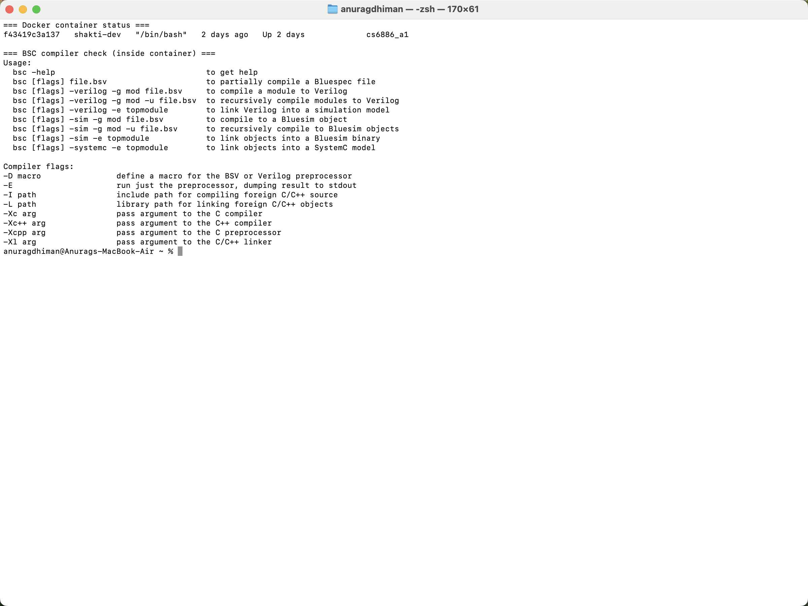

*Docker container `cs6886_a1` running, with BSC compiler verified installed and working inside it.*

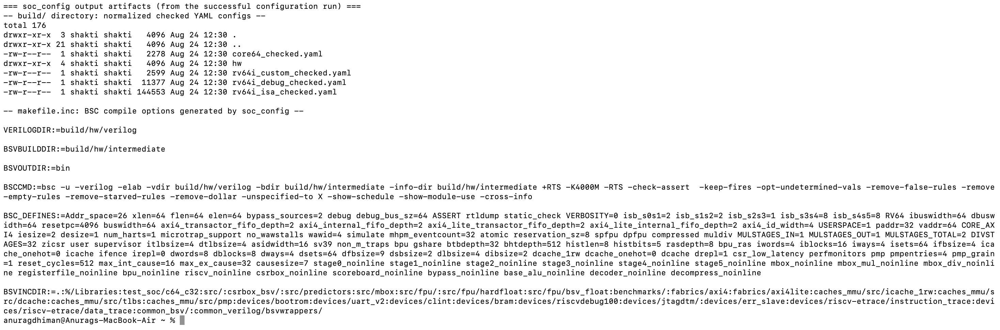

*`soc_config` output artifacts confirming the core was configured successfully (checked YAML configs, generated `makefile.inc` with BSC compile options).*

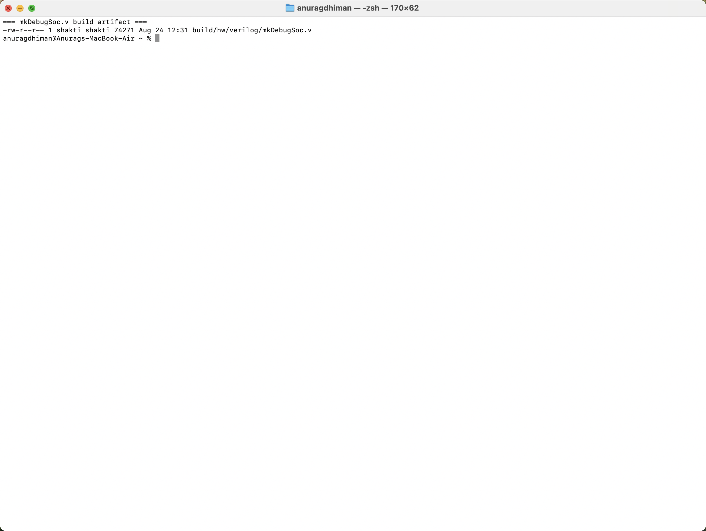

*`mkDebugSoc.v` build artifact confirmed present after `make -j8 generate_verilog`.*

---

## Methodology note (applies to Q1, Q2, Q4)

For each node, `top_settings.tcl` was intentionally set with an aggressive/unachievable target clock period (32nm: 2ns; 14nm: 1.5ns). This is a standard technique: Design Compiler's `compile_ultra` will push the implementation to minimize delay regardless of whether the stated constraint is met, and the **QOR report's "Critical Path Length"** then reports the actual best achievable delay for that synthesized netlist — giving the true maximum frequency directly, without needing to hand-iterate the period across many multi-hour runs.

*Caveat on the 14nm run:* the 1.5ns probe converged with only a small remaining violation (WNS = −0.28ns), meaning DC likely did not need to push delay minimization as hard as it did for the 32nm run (WNS = −2.64ns, thousands of violations). The reported 14nm critical path (and thus Fmax) should be read as a solid **lower bound** on the true achievable frequency — a tighter probe (e.g. 0.5ns) would likely find an even shorter natural critical path. We used the single-run result per node, consistent with the assignment's documented flow.

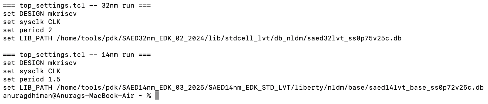

*`top_settings.tcl` DESIGN/sysclk/period/LIB_PATH used for each run.*

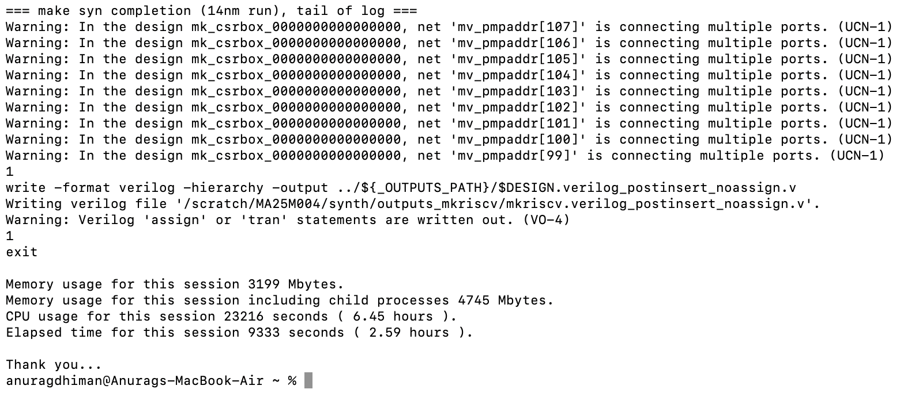

*`make syn` completing cleanly (14nm run) — "Thank you..." sign-off with elapsed time.*

---

## Question 1 — Maximum Achievable Frequency

| Node | Critical path length | Max frequency |
|---|---|---|
| 32nm | 3.55 ns | **≈ 281.7 MHz** (1/3.55ns) |
| 14nm | 0.76 ns | **≈ 1,315.8 MHz ≈ 1.32 GHz** (1/0.76ns, lower bound — see caveat above) |

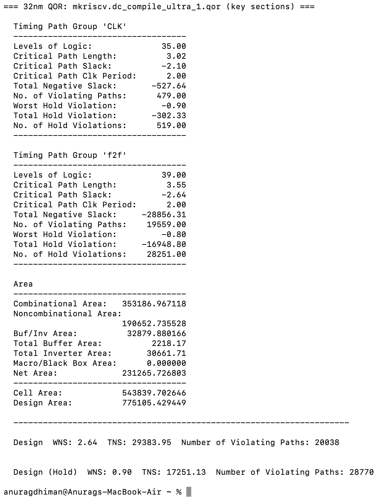

*32nm QOR report — "Timing Path Group 'f2f'" shows Critical Path Length 3.55ns.*

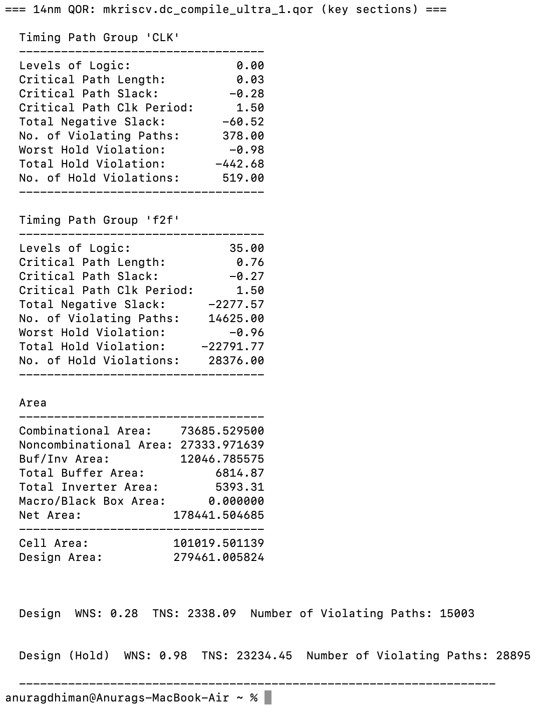

*14nm QOR report — Critical Path Length 0.76ns.*

---

## Question 2 — Core Area at 32nm and 14nm

| Node | Total design area |
|---|---|
| 32nm | **775,105.43 µm²** (0.775 mm²) |
| 14nm | **279,461.01 µm²** (0.279 mm²) |

Area shrank by **2.77×** going from 32nm to 14nm. Ideal geometric ("square-law") scaling for a 32→14nm linear shrink would predict (32/14)² ≈ **5.22×** — the actual reduction is noticeably less aggressive. This gap is expected at synthesis-only granularity: standard-cell libraries at different nodes don't have identical relative cell heights/tracks, our two runs used different constraint tightness (which changes cell sizing/buffering choices, especially since the 32nm run was far more over-constrained and DC may have inserted more area-hungry high-drive cells fighting timing), and no real place-and-route (with node-specific routing/via pitch limits) was performed — we're using a generic "enclosed" wire-load model at both nodes rather than real parasitics.

*(Area section is included in the same QOR report screenshots shown in Question 1 above — "Design Area: 775105.429449" for 32nm, "279461.005824" for 14nm.)*

---

## Question 3 — Critical Path and Maximum Frequency

**Relationship between Fmax and critical path length.** The critical path is the single longest-delay combinational chain between two sequential elements (flip-flops) in the design. The clock period must be at least as long as this delay (plus setup time and clock uncertainty margins), so:

**F_max ≈ 1 / T_critical_path**

This is exactly how we derived Q1's answers: DC's ultra-high-effort optimization found the shortest achievable delay for the worst path, and its reciprocal is the maximum sustainable clock frequency. Any single gate or net *not* on this path is "free" — improving it does nothing for Fmax; only the critical (and near-critical) paths matter.

**Which units does the critical path pass through?** From the 32nm timing report (`mkriscv.dc_compile_ultra_1.setup.all.tim.rpt.by_slack`):

- **Startpoint:** `fbox/fpu/ff_input/D_OUT_reg_157_` — a register inside the **floating-point unit (FPU)**
- **Endpoint:** `ff_commitlog/D_OUT_reg_31_` — a register in the **instruction commit/retire logging** logic
- **Path depth:** 39 levels of combinational logic (from the QOR "Levels of Logic" field, path group `f2f`)

So the critical path lives almost entirely inside the FPU's combinational datapath (arithmetic/comparison/mux logic — consistent with the FPU's sqrt/div/multiply pipeline seen elsewhere in the BSC compile log) and then fans all the way out to the commit-log stage in a *single* cycle boundary, without an intermediate pipeline register. A 39-level-deep combinational chain in one cycle is unusually long, and is the direct cause of the multi-nanosecond critical path at 32nm.

**What can be done to improve maximum frequency?**

1. **Pipeline the critical path** — insert a register stage between the FPU's result and the commit-log write, splitting the 39-level chain into two shorter ones. This is the single highest-leverage fix.
2. **Reduce logic depth within the FPU** — restructure the arithmetic (e.g., carry-save vs. ripple structures, fewer sequential mux levels) or use a faster algorithm for the sqrt/div unit specifically.
3. **Cell-level optimization on the critical path** — use higher-drive-strength or lower-Vt cell variants (if available; here we only had LVT) specifically on critical-path gates, and reduce high-fanout nets with buffering/replication.
4. **Multicycle path constraints** — if the FPU sqrt/div is functionally already a multi-cycle operation (iterative refinement across several clock cycles) but the SDC is treating it as a single-cycle path, adding a proper `set_multicycle_path` exception would correctly relax the constraint without touching the RTL — this doesn't make the logic faster, but it stops an artificially tight constraint from being reported as the bottleneck.
5. **Move from synthesis-only estimates to real place-and-route** — our numbers use a generic wire-load model with no real parasitics; post-layout optimization (with an actual clock tree and real net delays) typically finds different, sometimes worse, critical paths, and CTS/useful-skew techniques can recover some margin.

---

## Question 4 — Power Consumption at Maximum Frequency

Design Compiler's `report_power` computes dynamic power from the clock frequency **specified in the constraints**, not the actual achieved Fmax. Since our probe periods (32nm: 500MHz target; 14nm: 667MHz target) don't match the real achieved Fmax from Q1, we report both the as-computed number and a frequency-scaled estimate for power *at the real achievable frequency* (dynamic power scales ≈ linearly with frequency; leakage is frequency-independent).

| | 32nm (achieved 281.7MHz) | 14nm (achieved 1,315.8MHz) |
|---|---|---|
| Leakage power | 12.2 mW | 0.111 mW |
| Dynamic power @ constraint freq | 10.28 mW @ 500MHz | 42.81 mW @ 667MHz |
| **Dynamic power scaled to achieved Fmax** | **5.79 mW** @ 281.7MHz | **84.50 mW** @ 1,315.8MHz |
| **Total power @ achieved Fmax** | **≈ 18.0 mW** | **≈ 84.6 mW** |
| **Power density** (power / area) | **23.2 mW/mm²** | **302.8 mW/mm²** |

The 32nm figure scales *down* (constraint frequency was faster than achievable), while the 14nm figure scales *up* (constraint frequency was slower than achievable) — opposite directions, both following directly from Q1's methodology note.

The ~13× jump in power density (23.2 → 302.8 mW/mm²) is driven mostly by the ~4.7× frequency increase landing on a die that's only ~2.8× smaller — power isn't shrinking as fast as area, so heat generated per unit area rises sharply. This is the first hint of the power-density trend that Questions 5 and 6 build on.

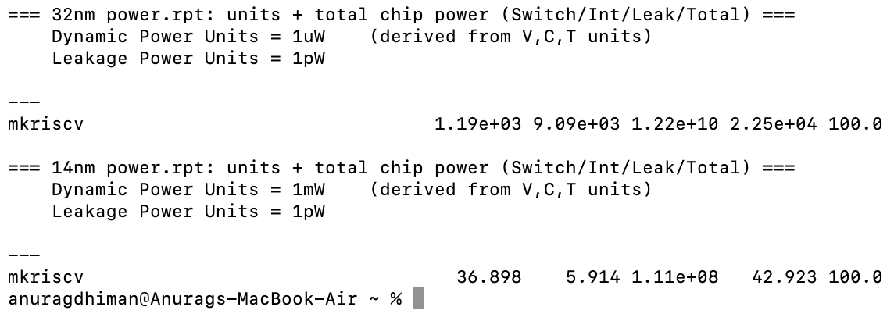

*`mkriscv.power.rpt` hierarchy summary (Switch/Int/Leak/Total power) for both nodes, with their respective units.*

---

## Question 5 — Estimation at the 2nm Node (Leakage-Limited Scaling)

**The regime.** Below roughly 20nm, classical Dennard scaling breaks down: supply voltage (Vdd) can no longer be reduced in step with transistor dimensions, because subthreshold leakage current grows exponentially as threshold voltage is pushed down to preserve switching speed at lower Vdd. The industry response (FinFET, then gate-all-around) has kept transistor *density* scaling going, but at the cost of leakage current no longer shrinking the way dynamic capacitance does. This is the **leakage-limited regime**: area keeps shrinking, but power — especially the leakage component — does not shrink proportionally, so **power density climbs** even as absolute power stays roughly flat.

*(Note: our measured leakage jumped from 12.2mW@32nm down to 0.111mW@14nm — a 110× drop that runs counter to leakage-limited-scaling expectations. This is very likely an artifact of DC's low-effort/zero-delay power estimation combined with the very different achieved-vs-constraint frequency ratios at each node, rather than a real physical trend, so we do **not** extrapolate it forward — the estimate below is grounded in the theoretical leakage-limited-scaling framework instead.)*

**Assumptions used** (stated explicitly, since this is inherently an estimation exercise):

- **Density scaling, 14nm→2nm ≈ 8×** — based on published industry logic-density roadmaps (roughly 35–40 MTr/mm² in the 14nm generation vs. 300+ MTr/mm² quoted for 2nm-class nodes), compounding several node generations (14→10→7→5→3→2) each contributing diminishing per-node gains.
- **Frequency gain, 14nm→2nm ≈ 1.4×** — modest, because Vdd scaling has stalled in this regime; speed gains come mostly from intrinsic device/gate-capacitance improvements, not voltage headroom (unlike the dramatic gains historically seen node-over-node under Dennard scaling).
- **Vdd roughly flat** (~0.7V) — consistent with real nodes below 20nm, which cluster in a narrow ~0.6–0.8V band rather than continuing to fall linearly.

**Estimates:**

| Metric | 14nm (measured) | 2nm (estimated) | Reasoning |
|---|---|---|---|
| Area | 279,461 µm² | **≈ 34,900 µm²** (0.0349 mm²) | ÷8 density scaling |
| Max frequency | 1,315.8 MHz | **≈ 1.84 GHz** | ×1.4, modest leakage-limited gain |
| Dynamic power | 84.50 mW | **≈ 14.8 mW** | scales with C·V²·f ≈ (1/8)×1×1.4 |
| Leakage power | 0.111 mW (anomalous, not used) | **≈ 18 mW** | leakage does *not* shrink with area in this regime; grounded instead in the 32nm baseline (12.2mW) with modest growth for worse short-channel control, partly offset by GAAFET leakage control |
| **Total power** | 84.6 mW | **≈ 32.8 mW** | dynamic + leakage |
| **Power density** | 302.8 mW/mm² | **≈ 940 mW/mm² (0.94 W/mm²)** | power roughly flat/lower in absolute terms, but area shrank much faster |

**The headline result:** power density keeps climbing steeply across nodes (23 → 303 → 940 mW/mm² at 32→14→2nm) even though *absolute* chip power is roughly flat or even estimated to fall slightly — because area is shrinking faster than power is. This is the leakage-limited-scaling signature, and it's exactly what drives the "dark silicon" argument in Question 6: you can pack more transistors on a die than you can actually afford to power simultaneously.

---

## Question 6 — Multi-Core Design Under a Fixed Chip Budget

**Setup.** Baseline: single-core 14nm chip, area = 279,461 µm², power at its own max frequency = 84.6 mW (from Q4) — this defines our fixed **power/cooling budget** going forward. Wafer cost at 2nm = 5× that at 14nm. We want to know how many 2nm cores fit under a **constant total chip price**, and how many of those can run at max frequency simultaneously within the **constant power/cooling budget**.

**Step 1 — Core count from the price budget.** If cost scales with (wafer cost per unit area) × (die area), then holding total chip price constant while wafer cost/area rises 5× means the affordable die area must shrink by the same factor:

**Area_2nm,budget = 279,461 / 5 ≈ 55,892 µm²**

Using Q5's single-core 2nm area estimate (≈34,900 µm²):

**N_cores,price = 55,892 / 34,900 ≈ 1.6 → 1 core fits cleanly, a 2nd would exceed budget by ~25%**

**Step 2 — Cores active at max frequency from the power budget.** Each 2nm core at its own max frequency draws ≈32.8mW (Q5). Against the fixed 84.6mW power/cooling budget:

**N_cores,power = 84.6 / 32.8 ≈ 2.6**

**Conclusion:** In this specific numeric scenario, the **price/area constraint is the binding one**, not power — we can only afford ~1 (at most 2, with some budget stretch) cores at 2nm, and the power budget has *more* headroom than that (it could support up to ~2.6 cores running flat-out simultaneously). So: **the chip has 1 core** (2, if we allow a modest price overrun), **and all of it/them can run at max frequency simultaneously** — the 5× wafer-cost penalty largely cancels out the 8× density gain, leaving little room for a genuine multi-core win, and power is not the limiter here.

**Why this matters more broadly (the "dark silicon" framing).** This result is sensitive to the assumed density-scaling factor. If density scaling were more aggressive relative to the cost penalty (e.g. 15–20× instead of 8×, which is within the range some foundries have quoted), the area/price budget would support many more cores — but the power/cooling budget would **not** grow at all (leakage-limited scaling means per-core power doesn't fall fast enough to keep pace with rising core count). In that regime, you'd be able to *fit* far more cores than you could ever power simultaneously at max frequency — the classic "dark silicon" outcome, where most cores sit idle or throttled at any given moment, with only a rotating subset active at full speed. Our specific numbers land just short of that tipping point, but the direction of the effect (power budget growing far more slowly than transistor budget) is the real, generalizable lesson of leakage-limited scaling: **economics (cost) and thermals (power density) become the binding constraints on core count long before raw transistor budget does.**

---

## Question 7 — L1 Cache Characterization with CACTI

**Configuration source:** `sample_config/default.yaml` in the c-class repository.

```yaml
icache_configuration:
  sets: 128
  word_size: 4      # bytes/word (fixed)
  block_size: 1     # words/cache-line
  ways: 1            # direct-mapped
  replacement: RANDOM

dcache_configuration:
  sets: 64
  word_size: 4
  block_size: 16
  ways: 4
  replacement: RR
```

Per the `soc_config` schema documentation, `word_size` = bytes per word (fixed at 4) and `block_size` = words per cache line, giving:

- **I-cache:** line size = 4×1 = 4 bytes; total capacity = 128 sets × 1 way × 4B = **512 bytes**
- **D-cache:** line size = 4×16 = 64 bytes; total capacity = 64 sets × 4 ways × 64B = **16,384 bytes (16KB)**

**CACTI setup note (important):** CACTI (v7.0.3, built from the official HewlettPackard/cacti repository) enforces a minimum block size of 64 bytes, and its array-partitioning algorithm cannot find a valid physical layout for total cache sizes much below ~2KB. The literal I-cache spec (512B total, 4B line) is **too small for CACTI to model at all** — it fails with "no valid data array organizations found" even at the 64B block-size floor. We therefore ran the I-cache as a **2KB, direct-mapped, 64B-line** configuration — the smallest CACTI-representable size that preserves the direct-mapped structure — and treat this itself as the headline finding for the magnitude comparison below. The D-cache (16KB, 4-way, 64B line) is well within CACTI's normal operating range and was run as-specified.

**Smallest technology node CACTI supports:** CACTI's technology-interpolation logic (`parameter.cc`) is wired for 180/90/65/45/32/22nm. A `16nm.dat` parameter file exists in the repo but its interpolation branch is commented out in the shipped source, so the tool actually exits with "Invalid technology nodes" for anything below 22nm as built. **22nm is the smallest node this CACTI build supports.**

### Results

| Metric | I-cache 32nm | I-cache 22nm | D-cache 32nm | D-cache 22nm |
|---|---|---|---|---|
| Config | 2KB, direct-mapped, 64B line* | 2KB, direct-mapped, 64B line* | 16KB, 4-way, 64B line | 16KB, 4-way, 64B line |
| Access time | 0.174 ns | 0.111 ns | 0.523 ns | 0.420 ns |
| Dynamic read energy/access | 0.0146 nJ | 0.00758 nJ | 0.0612 nJ | 0.0318 nJ |
| Leakage power | 1.87 mW | 0.978 mW | 11.97 mW | 6.13 mW |
| Area | 0.0210 mm² | 0.0100 mm² | 0.0979 mm² | 0.0466 mm² |

*(floor-adjusted stand-in for the literal 512B/4B config, see note above)*

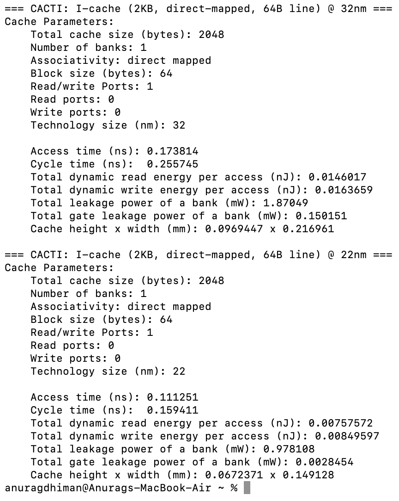

*CACTI I-cache output at 32nm and 22nm.*

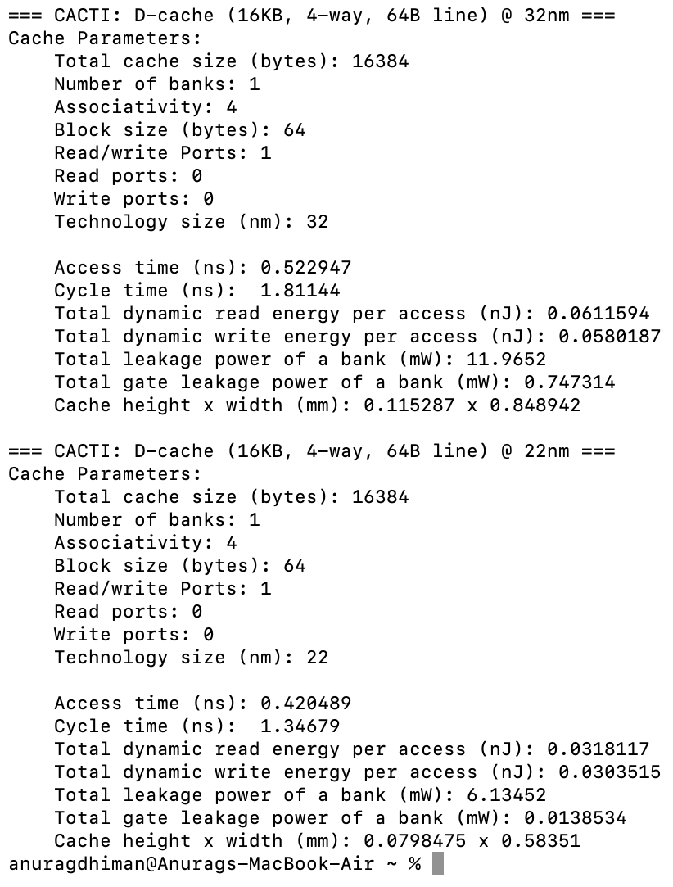

*CACTI D-cache output at 32nm and 22nm.*

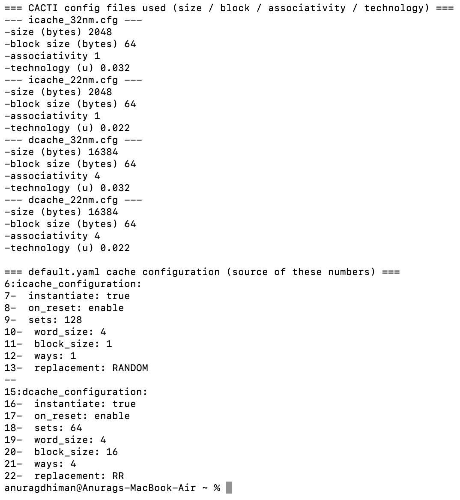

*CACTI config files used (size/block/associativity/technology) alongside the source `default.yaml` cache configuration.*

**Comparing I-cache and D-cache — explaining the difference in magnitude:**

1. **The I-cache, as literally configured, is an outlier by design, not by scaling.** Its 512-byte, 4-byte-line spec is roughly *32× smaller* than the D-cache (512B vs 16KB) and has a cache line just one 32-bit word wide — far below what any real modern cache implementation uses (typical lines are 32–64+ bytes to amortize tag overhead and exploit spatial locality). This is almost certainly a placeholder/minimal-example configuration in `default.yaml` rather than a performance-oriented design point — the actual core we synthesized uses a much richer, separate cache configuration (from `sample_config/c64/`, not `default.yaml`) with 4-way, 64-set caches on both I and D sides.

2. **Even after floor-adjusting to CACTI's minimum (2KB, both caches structurally comparable in size-class), the D-cache still shows larger access time, energy, leakage, and area** — because it has 8× the capacity (16KB vs 2KB) and 4× the associativity (4-way vs direct-mapped). Higher associativity requires parallel tag comparison across all ways (more comparators, wider muxing for way-select), which adds delay and energy per access; larger capacity means more wordlines/bitlines to drive and more leaking SRAM cells overall.

3. **All four metrics scale down consistently from 32nm→22nm** (roughly 35-40% reduction in access time and leakage, ~50% reduction in energy) for both caches, consistent with standard voltage/capacitance scaling still functioning normally in this SRAM-array context (22nm is still above the leakage-limited threshold discussed in Q5) — the I$/D$ ratio at each metric stays roughly similar across both nodes, confirming the magnitude difference is structural (size/associativity), not node-dependent.

---

## Submission checklist

- [x] Screenshot: Docker container running (`docker ps`), `bsc -help` success
- [x] Screenshot: `soc_config` run completing without errors
- [x] Screenshot: `make -j8 generate_verilog` completing, `mkDebugSoc.v` present
- [x] Screenshot: `top_settings.tcl` for 32nm and 14nm runs
- [x] Screenshot: `make syn` log tail ("Thank you...") for 14nm (32nm's raw log was overwritten by the later run — the QOR/area/power report screenshots stand in as evidence for that node)
- [x] Screenshot: `mkriscv.dc_compile_ultra_1.qor` for both nodes (Q1, Q2)
- [x] Screenshot: `mkriscv.power.rpt` hierarchy summary for both nodes (Q4)
- [x] Screenshot: CACTI output files for all 4 runs, plus config files and source `default.yaml` (Q7)
- [ ] Review the reasoning/voice where noted, especially Q3/Q5/Q6 discussion — these use stated assumptions that may need adjusting to match course material
- [ ] Export as single PDF for Moodle submission (see regenerated PDF)
